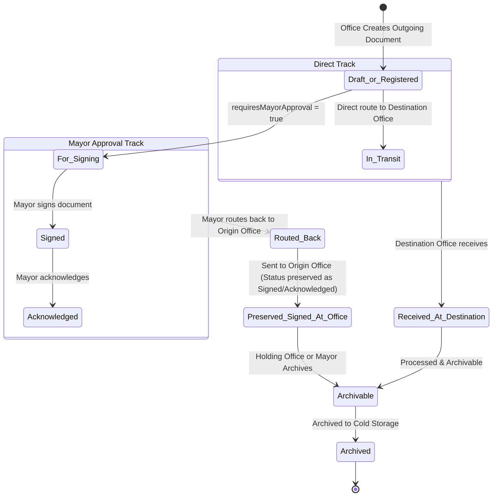

# Vinzons DigiPath — System Investigation Verification & Implementation Plan

**Date:** October 12, 2026  
**Document Version:** 1.0.0  
**Scope:** Investigation Verification, Root-Cause Analysis, and Detailed Action Plan for System Adjustments  
**Source Report:** Investigation Report (`page 1` PDF)

---

## 1. Executive Summary

During system testing and field inspection across three primary actor dashboards (**Mayor**, **Receptionist**, and **Office / Municipal Agriculture**), five key anomalies and workflow questions were identified:

1. **Error: "Action could not be saved"** when sending a document from an office to the Mayor, yet the document was still registered in the database.
2. **Missing Outgoing Records:** Files sent from an office disappear with no record in the office’s dashboard.
3. **Role Boundary Question:** Whether it is appropriate for files sent between offices (Office → Mayor) to appear on the Receptionist dashboard.
4. **Missing Priority Filter & Indicator:** Requirement to add a Priority Level filter and visual priority indicators across "All Documents".
5. **Action Reversion & Archive Button Disappearance in Mayor View:** After a document is signed, acknowledged, and sent back to the Office of Agriculture, reopening it causes the Reject, Sign, and Acknowledge buttons to reappear while the Archive button disappears.

This document verifies the technical root cause of each issue in the active codebase and outlines a comprehensive, step-by-step engineering plan to resolve them cleanly.

---

## 2. Problem Verification & Root-Cause Analysis

### Finding 1: Error "Action could not be saved" when sending a file from the Office to the Mayor (but it was registered)

#### A. Code References
* Frontend: [`dashboard/src/pages/DocumentList.jsx`](file:///d:/PROJECT/VinzonsDIGIPATH/dashboard/src/pages/DocumentList.jsx#L580-L587)
* Backend Routes: [`backend/routes/documents.js`](file:///d:/PROJECT/VinzonsDIGIPATH/backend/routes/documents.js#L233-L250) and [`backend/routes/documents.js`](file:///d:/PROJECT/VinzonsDIGIPATH/backend/routes/documents.js#L815-L838)
* Backend Scope: [`backend/utils/documentScope.js`](file:///d:/PROJECT/VinzonsDIGIPATH/backend/utils/documentScope.js#L17-L31)

#### B. Technical Root Cause
When an Office user clicks **"Send Document"** on their dashboard and submits the modal:
1. **First Mutation (`onAdd` / `POST /api/documents`):**
   In `DocumentList.jsx` (lines 583–586):
   ```javascript
   const saved = await onAdd(payload);
   if (isOfficeStaff && saved?.id && normalizedFormData.destinationOfficeId) {
     await sendDocument(saved.id, [normalizedFormData.destinationOfficeId]);
   }
   ```
   The backend's `normalizeDocumentPayload` evaluates the document type and destination:
   - If `requiresMayorApproval === true`, the backend automatically sets `currentOfficeId = mayorsOfficeId` and `status = 'For Signing'`!
   - The document is successfully saved to the database. Hence: *"it was registered"*.
2. **Immediate Second Mutation (`sendDocument` / `POST /api/documents/:id/send`):**
   Immediately after `onAdd` succeeds, the frontend fires `sendDocument(saved.id, [destinationOfficeId])`.
3. **The Fatal Conflict:**
   In `backend/routes/documents.js`:
   ```javascript
   router.post('/:id/send', sendRoles, asyncHandler(async (req, res) => {
     const doc = await assertCanAccessDocument(req, req.params.id);
     ...
     if (!isApprovalRole(req) && doc.currentOfficeId !== getUserOfficeId(req)) {
       return res.status(403).json({ message: 'Only the current office can send this document' });
     }
     if (toOfficeIds.includes(doc.currentOfficeId)) {
       return res.status(400).json({ message: 'Cannot send a document to its current office' });
     }
   ```
   - Because `currentOfficeId` was **already** assigned to the Mayor's Office during creation, `assertCanAccessDocument` (scoped to the Office user's office) throws `404: Document not found or not visible to your office`.
   - Even if accessed, `doc.currentOfficeId !== getUserOfficeId(req)` throws `403`, or `toOfficeIds.includes(doc.currentOfficeId)` throws `400: Cannot send a document to its current office`.
4. The backend error propagates to `runMutation` in `App.jsx`, triggering the modal dialog: **`"Action could not be saved"`**.

---

### Finding 2: The file sent from the office has no record in the office’s dashboard

#### A. Code References
* Backend Query Scoping: [`backend/utils/documentScope.js`](file:///d:/PROJECT/VinzonsDIGIPATH/backend/utils/documentScope.js#L17-L31)
* Frontend Filtering: [`dashboard/src/pages/DocumentList.jsx`](file:///d:/PROJECT/VinzonsDIGIPATH/dashboard/src/pages/DocumentList.jsx#L1002-L1009)

#### B. Technical Root Cause
In `backend/utils/documentScope.js`:
```javascript
const getOfficeDocumentVisibilityClauses = (officeId) => [
  { status: 'In Transit', destinationOfficeId: officeId },
  { status: { $ne: 'In Transit' }, currentOfficeId: officeId },
];
```
* Department offices only receive documents where:
  - The document is currently located in their custody (`currentOfficeId === officeId`), OR
  - The document is actively `In Transit` headed towards their office (`destinationOfficeId === officeId`).
* **The Missing Link:** There is **no clause** for documents originated by the office (`originOfficeId === officeId`) or documents routed/sent by the office (`sendHistory.fromOfficeId === officeId`).
* As soon as an office sends a document to the Mayor (or any destination), `currentOfficeId` switches to the destination office. The originating office completely loses visibility, making it impossible for staff to monitor status, review historical outbox documents, or see when the Mayor signs or acknowledges their submission.

---

### Finding 3: Role Boundary Question — "Is it right to see the file sent from the office on the receptionist dashboard?"

#### A. Architectural Answer
**NO, it is NOT right.**

#### B. Architectural & Business Rationale
1. **Separation of Duties in Vinzons DigiPath:**
   * **Receptionist Role:** Dedicated to the **external public entrance**. Responsible for citizen walk-ins, physical paper intake, scanner integration, public claim slip generation, SMS updates to citizens, and returning rejected external submissions.
   * **Office Staff Role:** Dedicated to **internal municipal departments** (e.g., Office of Agriculture, Engineering, MPDO, Budget, HR). They create internal communications, departmental resolutions, memos, and travel orders, routing them to the Mayor or peer departments.
   * **Mayor Role:** The executive sign-off authority for both citizen requests and internal department memos.
2. **Why the Receptionist Currently Sees It:**
   * In `dbcollections/vinzons_digipath.users.json`, the receptionist user `carlos` is assigned `officeId: "OFF-001"` (Mayor's Office).
   * When an office routes an internal document to the Mayor (`OFF-001`), the database query treats the Receptionist as a member of `OFF-001`.
   * `ReceptionistDashboard.jsx` does not filter out internal outgoing department communications (`documentDirection === 'Outgoing'`).
3. **Correct Behavior:**
   * Inter-office communications (Office → Mayor or Office → Office) are internal documents.
   * The Receptionist Dashboard should exclusively display **External Intake Documents** (`documentDirection === 'Incoming'`) or documents originated by the Reception desk. Internal departmental memos must be omitted from Receptionist queues.

---

### Finding 4: Add a filter for priority level and priority indication in "All Documents"

#### A. Code References
* Frontend State & Filters: [`dashboard/src/pages/DocumentList.jsx`](file:///d:/PROJECT/VinzonsDIGIPATH/dashboard/src/pages/DocumentList.jsx#L21)
* Backend Payload Normalizer: [`backend/routes/documents.js`](file:///d:/PROJECT/VinzonsDIGIPATH/backend/routes/documents.js#L262)
* Document Model: [`backend/models/Document.js`](file:///d:/PROJECT/VinzonsDIGIPATH/backend/models/Document.js#L38)

#### B. Technical Root Cause
1. `dashboard/src/pages/DocumentList.jsx` line 21 explicitly declares an empty array:
   ```javascript
   const priorityLevels = [];
   ```
2. The Document table toolbar includes filters for **Search**, **Date**, **Status**, and **Direction**, but **no Priority dropdown**.
3. In the document table, column headers misapplied the CSS class `documents-col-priority` to the "Sender" column, leaving no visual indicator (badge or tag) for document urgency.
4. In `backend/routes/documents.js` line 262, `normalizeDocumentPayload` hardcodes:
   ```javascript
   priorityLevel: 'normal',
   ```
   This discards any priority level (`urgent`, `high`, `normal`, `low`) selected by the user upon document creation!
5. In the Document Create / Edit modal, there is no form field allowing users to designate the document's priority level.

---

### Finding 5: Mayor View — Reopening signed/acknowledged documents resurrects Reject/Sign/Acknowledge buttons and removes Archive button

#### A. Code References
* Backend Send Route: [`backend/routes/documents.js`](file:///d:/PROJECT/VinzonsDIGIPATH/backend/routes/documents.js#L880-L893)
* Frontend Action Renderers: [`dashboard/src/pages/DocumentList.jsx`](file:///d:/PROJECT/VinzonsDIGIPATH/dashboard/src/pages/DocumentList.jsx#L880-L945)
* Backend Archive Conditions: [`backend/routes/archives.js`](file:///d:/PROJECT/VinzonsDIGIPATH/backend/routes/archives.js#L63-L67)

#### B. Technical Root Cause
Let us trace the exact sequence that occurs:
1. **Mayor Signs & Acknowledges:**
   * Mayor marks document as `Signed` (status becomes `'Signed'`).
   * Mayor marks document as `Acknowledged` (status becomes `'Acknowledged'`).
   * At this point, `finalWorkflowStatuses = ['Signed', 'Acknowledged']` is matched, and the document is eligible for archiving.
2. **Mayor Routes Document Back to Agriculture:**
   * The Mayor clicks **Send** and selects the destination: Municipal Agriculture (`OFF-008`).
   * The backend executes `POST /api/documents/:id/send`.
   * **Look at line 885 of `backend/routes/documents.js`:**
     ```javascript
     $set: {
       currentOfficeId: firstOfficeId,
       destinationOfficeId: firstOfficeId,
       lastRoutedAt: now,
       preTransitStatus: normalizeWorkflowStatus(doc.status, 'Received'),
       status: 'Received', // <--- FATAL OVERWRITE: Reverts Signed/Acknowledged to 'Received'
       sendHistory: [...existingHistory, ...sendEvents],
       sendQueue: remaining,
       timeline: [...existingTimeline, ...timelineEvents],
       updatedAt: now,
     }
     ```
3. **The Unintended Side Effects:**
   * The document's `status` is forcibly reset from `'Signed'` / `'Acknowledged'` back to `'Received'`.
   * In `DocumentList.jsx`:
     - `canArchiveDocument`: Checks `finalWorkflowStatuses.includes(status)`. Since status is now `'Received'`, this evaluates to `false` → **Archive button disappears!**
     - `canRejectDocument`: Checks `registrationStatuses.includes(status)` (`['Received', 'For Signing', 'For Filing']`). Evaluates to `true` → **Reject button reappears!**
     - `canTakeDocumentAction`: Checks `['Received', 'For Signing'].includes(status)`. Evaluates to `true` → **Signed button reappears!**
     - Checks `['Received', 'For Filing', 'For Signing', 'Signed'].includes(status)`. Evaluates to `true` → **Acknowledge button reappears!**
4. **Custody & Role Leak:**
   * The document is now at `currentOfficeId: "OFF-008"` (Municipal Agriculture).
   * `renderDocumentActions` lacks a check verifying whether the document is still in the Mayor's custody. Even though the Mayor already signed, acknowledged, and returned the file to Agriculture, the Mayor's detail view still offers buttons to re-sign or reject it.

---

## 3. System Architecture & Visibility Matrix

### Document Scoping & Visibility Matrix

| Role | Incoming to Office | In-Custody | Outgoing / Originated | Forwarded / History | External Citizen Intake | Internal Department Docs |
| :--- | :---: | :---: | :---: | :---: | :---: | :---: |
| **Admin** | Full Access | Full Access | Full Access | Full Access | Full Access | Full Access |
| **Mayor** | Full Access | Full Access | Full Access | Full Access | Full Access | Full Access |
| **Office** (e.g. Agriculture) | Yes (In Transit / Received) | Yes (Current Office) | **Yes (Read-Only Tracking)** *(Fix)* | **Yes (Read-Only Tracking)** *(Fix)* | No | Yes (Self-originated or received) |
| **Receptionist** | Yes (At Reception Desk) | Yes (Pending Mayor Review) | Yes (Citizen Intakes) | Yes (Intake History) | **Full Access** | **Hidden (Excluded)** *(Fix)* |

### Workflow State Transitions



---

## 4. Detailed Implementation Plan

### Phase 1: Backend Fixes & Enhancements

#### 1.1 Atomic Outgoing Document Creation (`backend/routes/documents.js`)
* **Objective:** Prevent the duplicate `sendDocument` call error and ensure atomic creation & routing.
* **Changes:**
  - In `normalizeDocumentPayload`:
    - Respect incoming `priorityLevel` (`urgent`, `high`, `normal`, `low`). Do not override with `'normal'`.
    - When an Office user creates an Outgoing document with a `destinationOfficeId`:
      - If `requiresMayorApproval === true`: Route path starts with origin, passes through Mayor's office for signing, with `routePlan = [originOfficeId, mayorsOfficeId, ...]`.
      - Record the initial send/route event cleanly in `sendHistory` and `timeline` upon creation so the frontend does not need to dispatch a subsequent `POST /:id/send` request.
      - If the document is initialized at the origin office awaiting physical dispatch, maintain `currentOfficeId = originOfficeId` until explicitly sent.

#### 1.2 Preserve Completed Workflow Status on Send (`backend/routes/documents.js`)
* **Objective:** Ensure sending a signed/acknowledged document does not wipe out its completion status.
* **Changes:**
  - In `POST /api/documents/:id/send`:
    - Check the current document status:
      ```javascript
      const isCompletedStatus = ['Signed', 'Acknowledged'].includes(doc.status);
      const nextStatus = isCompletedStatus ? doc.status : 'Received';
      ```
    - Preserve `status: nextStatus`.
    - If `isCompletedStatus` is true, mark `mayorApprovalCleared: true` and preserve `completedAt`.
    - Only reset to `'Received'` if the document was in an uncompleted intake state (`For Signing`, `Received`, `For Filing`).

#### 1.3 Office & Receptionist Scoping Updates (`backend/utils/documentScope.js`)
* **Objective:** Give departments visibility into their outgoing files while keeping Receptionist focused exclusively on external citizen intake.
* **Changes:**
  - For `Office` users: Expand `getOfficeDocumentVisibilityClauses(officeId)` to include:
    - `{ originOfficeId: officeId }`
    - `{ 'sendHistory.fromOfficeId': officeId }`
  - For `Receptionist` users:
    - Restrict queries to external citizen documents: `{ documentDirection: 'Incoming' }`.
    - Filter out internal office-to-office and office-to-mayor communications (`documentDirection !== 'Outgoing'`).

#### 1.4 Archiving Rule Alignment (`backend/routes/archives.js`)
* **Objective:** Ensure signed/acknowledged documents can be archived by authorized approval users regardless of whether they have been sent back to an office.
* **Changes:**
  - Allow archiving of documents whose status is `Signed` or `Acknowledged` (or `statusBeforeArchive: 'Signed'`).

---

### Phase 2: Frontend Dashboard Adjustments

#### 2.1 Single-Operation Outgoing Submit (`dashboard/src/pages/DocumentList.jsx`)
* **Objective:** Eliminate the double-mutation failure ("Action could not be saved").
* **Changes:**
  - In `handleFormSubmit`:
    - When `isOfficeStaff && !editingDoc`, pass `destinationOfficeId` directly in `payload`.
    - Remove the secondary `await sendDocument(saved.id, [normalizedFormData.destinationOfficeId])` call if the backend already handles the initial route on document creation.
    - Provide clear validation feedback if destination is missing.

#### 2.2 Outgoing Document Custody & Read-Only Action Guards (`dashboard/src/pages/DocumentList.jsx`)
* **Objective:** Prevent illegal actions while maintaining full read/tracking access.
* **Changes:**
  - When an Office user views a document where `doc.originOfficeId === myOfficeId` but `doc.currentOfficeId !== myOfficeId`:
    - Show an **"Outgoing / In Transit"** custody badge.
    - Render timeline, tracking details, and attachments in read-only mode.
    - Disable or hide action buttons (Edit, Delete, Send, Reject) since physical custody is currently with another office.

#### 2.3 Mayor Action Buttons & Archive Button Logic (`dashboard/src/pages/DocumentList.jsx`)
* **Objective:** Fix button resurrection and restore the Archive button.
* **Changes:**
  - Update `canRejectDocument(doc)`:
    - Prohibit rejection if the document is already `Signed`, `Acknowledged`, or `Archived`.
    - Only allow rejection when the document is currently in Mayor custody (`doc.currentOfficeId === mayorsOfficeId`).
  - Update `canTakeDocumentAction(doc)`:
    - If `doc.status === 'Signed'`, hide the **"Signed"** button.
    - If `doc.status === 'Acknowledged'`, hide both **"Signed"** and **"Acknowledge"** buttons.
    - Require `doc.currentOfficeId === currentUser?.officeId` for intake actions (Mayor can only sign if document is currently at Mayor's Office).
  - Update `canArchiveDocument(doc)`:
    - Show the **Archive** button whenever `['Signed', 'Acknowledged'].includes(getWorkflowStatus(doc))` and `isApprovalUser` is true.

#### 2.4 Priority Level Filter, Badge & Form Selector (`dashboard/src/pages/DocumentList.jsx`)
* **Objective:** Add priority filter and visual indicator in "All Documents".
* **Changes:**
  - Define `priorityLevels = ['All', 'Urgent', 'High', 'Normal', 'Low']`.
  - Add state: `const [filterPriority, setFilterPriority] = useState('All');`.
  - Add **Priority dropdown** in the toolbar:
    ```jsx
    <div className="filter-dropdown">
      <label>Priority</label>
      <select className="form-select" value={filterPriority} onChange={e => setFilterPriority(e.target.value)}>
        {priorityLevels.map(lvl => (
          <option key={lvl} value={lvl}>{lvl}</option>
        ))}
      </select>
    </div>
    ```
  - Apply `filterPriority` in `filteredDocs`.
  - Add a dedicated **Priority Column / Badge** in the table:
    - Urgent: `<span className="badge badge-urgent">Urgent</span>` (red)
    - High: `<span className="badge badge-high">High</span>` (orange/amber)
    - Normal: `<span className="badge badge-normal">Normal</span>` (blue/slate)
    - Low: `<span className="badge badge-low">Low</span>` (gray)
  - In the Document Create/Edit modal:
    - Add a `Priority Level` dropdown with choices `Normal`, `Urgent`, `High`, `Low`.

#### 2.5 Receptionist Dashboard Filtering (`dashboard/src/pages/ReceptionistDashboard.jsx`)
* **Objective:** Exclude internal department documents from Receptionist queues.
* **Changes:**
  - Filter `pendingDocuments`, `todayDocs`, and `forwardedToMayorDocs` to only include documents where `d.documentDirection === 'Incoming'`.
  - Ensure department-generated outgoing documents do not appear in the Receptionist's tables or stat cards.

---

## 5. Verification & Testing Checklist

### Test Scenario 1: Office Creates & Sends Document to Mayor
* [ ] Login as Office user (e.g., `unc / unc123` or Municipal Agriculture staff).
* [ ] Click **"Send Document"**.
* [ ] Select Destination Office: **Mayor's Office**. Set Priority: **Urgent**. Attach a scan. Submit.
* [ ] **Verify:** No "Action could not be saved" error modal appears. Success toast displays.
* [ ] **Verify:** The created document appears in the Office dashboard under "My Documents" (with an Outgoing badge).
* [ ] **Verify:** The document displays the **Urgent** priority badge.

### Test Scenario 2: Receptionist Dashboard Role Boundary Check
* [ ] Login as Receptionist (`receptionist / recep123`).
* [ ] Check "Incoming", "Pending", and overview tables.
* [ ] **Verify:** The internal document sent from Agriculture to Mayor in Test 1 is **NOT** present on the Receptionist dashboard.
* [ ] Register an external citizen document via Reception form.
* [ ] **Verify:** External document appears in Receptionist tables and forwards to Mayor as expected.

### Test Scenario 3: All Documents Priority Filter & Indication
* [ ] Login as Admin or Mayor.
* [ ] Navigate to **Documents** ("All Documents").
* [ ] Select Priority Filter: **Urgent**.
* [ ] **Verify:** Only urgent documents are listed.
* [ ] Select Priority Filter: **Normal**, then **All**.
* [ ] **Verify:** Filter functions smoothly, and each row clearly indicates its priority badge.

### Test Scenario 4: Mayor Sign, Acknowledge, Route Back & Archive Flow
* [ ] Login as Mayor (`mayor / mayor123`).
* [ ] Open the document received from Office of Agriculture.
* [ ] Click **Signed** → Confirm timeline event added and status becomes `Signed`.
* [ ] Click **Acknowledge** → Confirm status becomes `Acknowledged`.
* [ ] Click **Send** → Select Municipal Agriculture (`OFF-008`).
* [ ] Reopen the document in the Mayor view.
* [ ] **Verify:**
  1. The Reject button does **NOT** reappear.
  2. The Sign and Acknowledge buttons do **NOT** reappear.
  3. The status remains **Signed** / **Acknowledged**.
  4. The **Archive** button is visible and functional.
* [ ] Click **Archive** → Document moves cleanly to Archives.
* [ ] Login as Agriculture staff → Confirm the document shows as signed and archived in their history.

---

## 6. Approval & Execution Sign-Off

Upon user review and confirmation of this plan, implementation will proceed systematically starting from Phase 1 (Backend Services & Scoping) through Phase 2 (Frontend UI & Dashboards), followed by rigorous automated and manual test verification.
