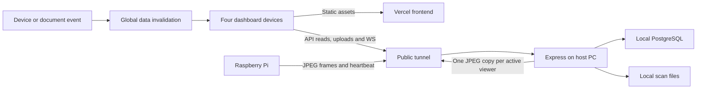

# Multi-user performance and reliability audit

Date: 28 October 2026, Asia/Manila. Runtime samples: approximately 11:34–11:42 AM.

Reviewed revision: `73cf88fd14a7ddc85771a3431c6dd9a5e50a0328`, branch `main`.

Reported workload: four users on separate devices, sometimes using different internet connections; slowdown affects the whole application.

## Assessment

The strongest measured cause is excessive document response size, multiplied by full application reloads in every browser. The 80 document records serialize to **34,170,244 bytes**, of which **33,989,182 bytes (99.47%)** are in `scannedImageUrl`. Thirty-seven documents have embedded `data:` scans in that field. The attachment records already use file URLs. Even a page that needs only a count or status downloads the complete document records.

The application then amplifies this payload: a persisted device event or a document change can make every connected browser reload all its collections. Four browsers generate **32–44 HTTP requests per reload round**, depending on their roles. A round with one Admin, Mayor, Receptionist, and Office user generates **40 requests**. Requests can overlap without deduplication.

There are also confirmed routing and reliability defects that can appear as slowness: inconsistent tunnel URLs, frontend HTML accepted as a working API, no normal request deadlines, and database failures misreported as expired logins. Camera relay traffic shares the same origin connection and adds bandwidth for every active viewer.

The current database is not large enough to justify blaming record count alone. Missing indexes and a five-connection pool can worsen contention, but the payload and request patterns deserve correction first. Switching tunnel providers alone would retain these application problems.

## Scope, method, and limits

Reviewed dashboard bootstrap, role-specific data loading, mutations, realtime events, document/list/report rendering, Express routes, authentication, Sequelize compatibility code, PostgreSQL schema and indexes, device presence, command delivery, JPEG relay, Pi heartbeat/fallback behavior, startup scripts, configuration synchronization, and production bundle output.

Validation included:

- Read-only PostgreSQL transactions for exact row counts, field sizes, indexes, statistics, and `EXPLAIN (ANALYZE, BUFFERS)` on SELECT queries.
- Isolated execution of the actual frontend/backend source with fake requests, sockets, or model storage. These reproduce behavior without changing real records.
- Bounded unauthenticated GET requests to local status, configured tunnels, and the deployed Vercel frontend/bundle.
- All 33 existing backend, frontend utility, and startup tests passed. The production dashboard build passed.

No application configuration, database records, Pi hardware, running services, deployments, or Git branches were changed. The build generated ignored `dashboard/dist` output; the report and evidence are new documentation files. No real credentials or document contents are included in the evidence.

There was no listener on local port 5000 during the runtime snapshot, so this is **not a measured four-browser production load test**. It establishes concrete defects and payload costs, not an exact simultaneous-user capacity or historical p95 latency. The public tunnel responses are a point-in-time availability sample, not proof of what every device experienced earlier.

## Request and resource path



Different client ISPs still converge on the same backend and its available network path. Vercel serving the frontend does not move Express, PostgreSQL, or the JPEG relay off the host PC.

## Measured baseline

| Item | Observation |
| --- | ---: |
| Users in database | 17 |
| Documents | 80 |
| Transmissions / archives | 30 / 6 |
| Activity logs | 9,462 |
| Device events / commands | 531 / 123 |
| Complete Document model JSON | 34.17 MB |
| Embedded cover field bytes | 33.99 MB across 37 documents |
| Attachment entries | 72; no top-level inline `dataUrl` or inline `url` entries |
| OCR text / attachment JSON / timeline JSON | 11.3 KB / 27.4 KB / 53.6 KB |
| Document JSON excluding cover, attachments, OCR, and timeline | 87,889 bytes |
| Gzip of complete document JSON, comparison only | 23.47 MB |
| Complete log-table JSON representation | Approximately 1.81 MB |
| Local audit-process JSON stringify / parse sample | 47.05 ms / 39.73 ms |
| Document SELECT executor time, two samples | 0.355–0.412 ms |
| Log SELECT and sort executor time, two samples | 39.498–47.891 ms |
| Latest hardware event SELECT executor time | 0.384–5.704 ms |
| Recorded database deadlocks / temporary files | 0 / 0 |
| Installed Sequelize pool default | Maximum 5 connections, acquire timeout 60 seconds |

MB and KB above use decimal units. The Document byte count uses the 44 columns selected by the actual Sequelize model and `JSON.stringify`. Log/table size measurements use PostgreSQL JSON aggregation and are close payload estimates, not captured HTTP responses. SQL executor timings do not include transferring, parsing, and serializing large values. Gzip is a local comparison; compression on a working production API could not be verified.

Four full-access document downloads alone represent **136.68 MB** of application JSON before logs and other collections. On an illustrative **10 Mb/s shared origin connection**, that requires approximately **109 seconds** of uncompressed transfer time in aggregate. This is bandwidth arithmetic, not a measured internet speed or latency result. Scoped users can receive fewer documents; four active users do not necessarily mean four camera viewers.

Evidence: [database detail measurements](audit-evidence-2026-10-28/database-details.json), [runtime observations](audit-evidence-2026-10-28/runtime-observations.json), [source probe results](audit-evidence-2026-10-28/source-probe-results.json).

## Findings

### F01 — P1: embedded scan data is returned in every document list

**Confirmed by database measurement and source.** Thirty-seven `scannedImageUrl` values contain `data:` media and account for almost the entire 34.17 MB list. `GET /documents` returns complete records without pagination or a summary projection. The same complete collection is requested regardless of the current page.

The creation path persists `scannedFiles` to disk but gives `body.scannedImageUrl` priority over the resulting file URL. The browser scanner supplies `combinedPdf.dataUrl`, so the same scan can be stored as a file and retained inline in the document cover column. This explains how oversized rows continue to enter the database.

Evidence: [list response](../backend/routes/documents.js#L508), [cover preference](../backend/routes/documents.js#L410), [attachment persistence](../backend/utils/attachments.js#L82), [scanner payload](../dashboard/src/components/Scanner.jsx#L1645).

**Fix:** make list responses small, paginated summaries; fetch attachments/OCR/history only on document open. For new registrations, derive the cover from persisted attachments. Separately migrate existing inline covers only after verifying the corresponding stored file. Preserve previews, PDFs, permissions, and historical scans during that migration. Merely adding gzip leaves a 23.47 MB document response in this sample.

### F02 — P1: global invalidation multiplies full collection reloads

**Reproduced against the actual callback and data service.** Every `data:invalidate` containing `device`, `device-events`, `documents`, or `logs` calls `loadData()`. That loads 11 endpoints for Admin/Mayor, 10 for Receptionist, or 8 for Office. The server broadcasts invalidations to all authenticated sockets. A persisted hardware event specifically invalidates `device-events`.

The service has no in-flight promise, cancellation, debounce, or collection-aware loading. Three overlapping Admin reloads generated **33 requests**, compared with 11 for one reload. Mutations trigger local refreshes while the server sends an invalidation, and reconnects also request the complete dataset. Responses can finish out of order and replace newer browser state.

The heartbeat persistence throttle defaults to 45 seconds when WS is connected; this is **not** a claim that every three-second heartbeat always downloads all data. When WS is down, heavy heartbeat persistence occurs more often. Ordinary user changes also trigger this path.

Evidence: [loadAll](../dashboard/src/api/documentService.js#L447), [invalidation and reconnect callbacks](../dashboard/src/App.jsx#L314), [mutation refresh](../dashboard/src/App.jsx#L234), [global broadcast](../backend/ws/realtimeHub.js#L628), [hardware invalidation](../backend/services/devicePresence.js#L183).

**Fix:** update device state directly; refetch only invalidated collections used by the current page. Deduplicate in-flight queries, coalesce related events, and discard obsolete responses. Cache stable offices, users, and document types. A device-only event should cause no document/log download.

### F03 — P1: API discovery and inconsistent URLs cause delays and failed routing

**Confirmed in code, source probes, and current public GET responses.** Current local configuration disagrees:

| Consumer | Configured location |
| --- | --- |
| Backend, Pi runtime, and deployed Vercel bundle | `zt0pntkq-5000.asse.devtunnels.ms` |
| `network.env` source | `t2z0wjm9-5000.asse.devtunnels.ms` |
| Local dashboard environment | Relative `/api` |

At observation time, local port 5000 refused connections; the first tunnel's `/api/status` returned 404; the network-source tunnel exceeded the 6.5-second deadline. Vercel `/api/status` and `/api/config` returned **200 HTML**, the same size as the frontend page, not API JSON. No POST login or real authenticated action was attempted.

Discovery accepts `status.ok` without checking API JSON or content type. An isolated source probe selected the frontend as an API after a configured API failed. The same unavailable environment candidate was tried twice. Sequential eight-second probes delay rendering because bootstrap completes before React mounts. Another source probe showed that config preloading can overwrite the working local `/api` route with a public tunnel URL. `/api/config` is cacheable for an hour.

Evidence: [discovery](../dashboard/src/api/apiBase.js#L164), [config URL override](../dashboard/src/api/apiBase.js#L106), [render gate](../dashboard/src/main.jsx#L30), [Vercel rewrite](../dashboard/vercel.json), [config response cache](../backend/server.js#L63), [network synchronization](../scripts/sync-network-config.js#L247).

**Fix:** establish one reachable backend URL and keep API, WS, Pi, and deployed frontend consistent. Require an expected JSON health schema; never treat frontend HTML as API health. Deduplicate candidates, preserve a working local proxy, provide a bounded startup error, and invalidate configuration caches after URL changes. Align configuration without silently replacing the new Pi tuning.

### F04 — P1: one stalled request blocks the entire dashboard; DB errors log users out

**Reproduced.** Normal JSON and blob requests have no request deadline. `loadAll()` uses a single `Promise.all`; failure of the logs endpoint rejects all collection loading, and an unresolved logs request keeps the load pending. State is committed only after the whole batch succeeds. Silent refresh failures can leave stale data without a visible explanation.

Authentication performs a user database lookup on every protected request. Its single catch handles both JWT errors and database failures as 401. A mocked connection-acquisition failure was returned as **“Invalid or expired token”**. The frontend treats a 401 on ordinary requests as an expired session and clears the login. Contention can therefore look like random logout rather than a database availability problem.

Evidence: [fetch requests](../dashboard/src/api/documentService.js#L110), [all-or-nothing load](../dashboard/src/api/documentService.js#L467), [state commit](../dashboard/src/App.jsx#L158), [authentication catch](../backend/middleware/auth.js#L20).

**Fix:** use separate deadlines for reads, uploads, and exports; abort superseded requests. Load independent page sections separately with per-section errors. Distinguish token failures from database timeouts; return 503 for temporary infrastructure failures and preserve valid sessions.

### F05 — P2: camera previews compete with APIs and scale per active viewer

**Confirmed architecture and isolated relay probe; no real stream bitrate measured.** Each subscribed browser receives its own JPEG copy through Express and the public tunnel. A 100,000-byte JPEG sent to four fake subscribers produced 400,000 outgoing bytes per frame: **48 Mb/s at 15 fps**. This is an example, not a claim that all four reported users were watching video.

The current Pi file requests 720p preview, up to 15 fps, and a 140,000-byte JPEG target. Actual JPEG sizes and adaptive behavior vary. The backend supplies a subscriber count, but the Pi's hint handler does not use it to stop idle streaming. A byte-buffer check drops frames for slow clients, which helps, but does not isolate API capacity or save the initial Pi-to-backend stream when no one watches. The declared client-buffer-frame setting is not used by the relay.

Evidence: [relay](../backend/ws/realtimeHub.js#L543), [Pi hint handling](../pi_ws_scanner.py#L697), [scanner subscription](../dashboard/src/components/Scanner.jsx#L950).

**Fix:** stream only for active, visible viewers; offer a lower-bandwidth preview and avoid duplicate viewing. Keep document/command traffic responsive under preview load. Measure actual bytes/sec, send queues, and viewer count before selecting an encoding/hosting change.

### F06 — P2: HTTPS preview fallback exceeds its own rate limit

**Reproduced.** `/devices/stream/frame` uses `deviceLimiter`, capped at 300 requests/minute. HTTP preview fallback can upload at the effective frame rate. A 15-fps fallback attempts 900 uploads/minute, reaching a 300-request allowance in approximately **20 seconds**, excluding request latency. The isolated limiter allowed 300 requests and rejected request 301.

This affects fallback when WS frames are not flowing; it does not mean healthy binary WS preview is subject to this HTTP limit. The key also ignores the query-string `deviceId` used by frame uploads.

Evidence: [frame route](../backend/routes/devices.js#L407), [limiter](../backend/utils/rateLimit.js#L35), [fallback upload](../pi_ws_scanner.py#L3114).

**Fix:** define a separate authenticated frame-ingest policy keyed by validated device identity and compatible with a bounded preview frame rate. Honor Retry-After/backoff. Keep stricter limits for commands and control endpoints.

### F07 — P2: schema/query shape and connection pressure magnify wasted work

**Confirmed indexes, query timings, and installed library defaults.** The database has primary-key indexes and four duplicate unique indexes each on document tracking number and username, but no supporting indexes on device-event filters, pending-command filters, transmission relationships, office document filters, or log ordering. Logs currently require a 39–48 ms SELECT/sort and return approximately 1.81 MB in full.

The app does not configure the Sequelize pool, so the installed default is five connections with a 60-second acquisition timeout. That is five concurrent database connections, not a five-user limit. Eleven parallel HTTP requests per browser each perform authentication and data reads. Notifications pass through the root-mounted device router's authentication before their own router's authentication, adding another user lookup. Device snapshots perform three queries, including recounting scan events.

These patterns can queue work, but a quiet snapshot is not proof that the pool is exhausted in real use. `pg_stat_user_tables.n_live_tup` was substantially stale for several tables; exact COUNTs, not those estimates, are used in this report.

Evidence: [DB configuration](../backend/config/db.js), [installed pool defaults](../backend/node_modules/sequelize/lib/dialects/abstract/connection-manager.js#L20), [snapshot queries](../backend/services/devicePresence.js#L44), [router mounting](../backend/routes/index.js#L43), [notification authentication](../backend/routes/notifications.js#L58), [logs route](../backend/routes/logs.js#L14).

**Fix:** first reduce payloads/reloads; paginate logs and event history. Add targeted indexes using real query plans, especially latest device events, pending commands, transmission document lookups, and log ordering. Review duplicate constraints/index dependencies before removing anything. Measure pool waits and query duration; do not simply enlarge the pool. See [Sequelize pool guidance](https://sequelize.org/docs/v6/other-topics/connection-pool/) and [PostgreSQL statistics documentation](https://www.postgresql.org/docs/18/monitoring-stats.html).

### F08 — P2: `.select('id')` silently fetches full documents

**Reproduced against the actual compatibility wrapper.** Positive field projection is ignored. A `.find({}).select('id').lean()` test passed no Sequelize `attributes` option and returned OCR/history fields. Office/receptionist archive visibility and sender-notification visibility both use this pattern. They load complete visible documents, potentially including inline scans, just to collect their IDs.

This extra work may occur inside multiple endpoints in the same full reload, even when those endpoints return small final results.

Evidence: [projection implementation](../backend/models/ModelWrapper.js#L227), [query execution](../backend/models/ModelWrapper.js#L243), [archive visibility](../backend/routes/archives.js#L54), [sender visibility](../backend/routes/notifications.js#L20).

**Fix:** implement real selected-column support, preferably replace intermediate ID loading with database joins/subqueries, and add server pagination with tested role scoping.

### F09 — P1 correctness: simultaneous document updates can lose history

**Reproduced with actual update code and isolated storage.** `findOneAndUpdate` implements `$push`, `$addToSet`, and `$inc` as read-modify-write in JavaScript. Two concurrent updates both read the same record; the probe ended with **one history event and a counter of one**, instead of two events and a counter of two. Multi-step transmission/command flows also check pending state separately from inserting or updating it.

This is a multi-user correctness defect, not a measured source of network latency. Repeated attempts and inconsistent screens can compound the perceived slowdown.

Evidence: [read/modify/write](../backend/models/ModelWrapper.js#L316), [timeline append](../backend/utils/helpers.js#L86), [pending transmission check](../backend/routes/transmissions.js#L113).

**Fix:** use atomic SQL operations for counters and JSONB updates; use transactions/row locks or optimistic version checks for document workflow changes. Enforce one pending handoff/command where required by the workflow. Test two users acting on the same document concurrently.

### F10 — P2: WS presence handler is registered before the hub exists

**Reproduced using the real initialization order.** `server.js` requires `registerRealtime` before calling `initRealtimeHub`. The registration wrapper uses optional chaining on a null hub, so the callback is discarded. The isolated probe initialized the hub afterwards and found `presenceHandler === null`.

HTTP heartbeat fallback remains available, so this does not imply preview always fails. It does mean the intended WS presence path does not apply or persist events, adding reliance on fallback and confusing status/timing behavior.

Evidence: [registration order](../backend/server.js#L49), [hub initialization](../backend/server.js#L82), [registration wrapper](../backend/utils/realtime.js#L33).

**Fix:** initialize the hub before registering handlers, or preserve callbacks until initialization. Test WS-only heartbeat and connect/disconnect status with HTTP fallback disabled in a controlled test.

### F11 — P2/P3: initial bundle and report rendering add client-side cost

**Build measured; rendering cost inferred from source, not device profiling.** The main production JavaScript bundle is approximately **1.49 MB minified / 433 KB gzip**; the PDF worker asset is approximately 1.38 MB. App imports scanner, reports, and PDF-related UI eagerly. A worker asset being built does not prove every page downloads it immediately.

Reports compute full-array filters and sorts during render. The clock hook updates once per second, so the computations run again even if report data and filters are unchanged. Activity/list UIs paginate arrays already downloaded in full. The top-level App also derives multiple sorted/scoped arrays on rerenders, including device updates.

Server Word export fetches seven collections before applying range filtering, then performs synchronous DOCX/ZIP generation on the same Node process. At greater report sizes it can delay unrelated requests and WS callbacks. Current sender notifications use `outbox`, so external SMS/webhook delivery is not an active cause in this configuration; providers would add unbounded fetch waits if enabled.

Evidence: [eager imports](../dashboard/src/App.jsx#L15), [report calculations](../dashboard/src/pages/ReportsPage.jsx#L95), [clock tick](../dashboard/src/hooks/usePhilippinesClock.js#L49), [server report loading](../backend/routes/reports.js#L112), [synchronous ZIP](../backend/utils/reportDocx.js#L711).

**Fix:** lazy-load scanner/PDF/report features; memoize report calculations and isolate the clock. Aggregate/filter reports in SQL with bounded ranges. Move sufficiently expensive generation to a worker/job and apply deadlines to configured external providers. This follows [Node's event-loop guidance](https://nodejs.org/en/learn/asynchronous-work/dont-block-the-event-loop).

### F12 — P2/P3: production operation and measurements are incomplete

The launcher starts nodemon and the Vite development server; backend `.env` declares development mode. Express has no application response compression middleware, timing/size instrumentation, pool-wait metrics, or event-loop delay metrics. A reverse proxy may compress responses, but that could not be verified against a working API in this run. `npm start` runs configuration synchronization and can reintroduce the source URL and stream settings before startup.

The host snapshot showed 16 logical processors and roughly 16 GB RAM with about 5.7 GiB free. PostgreSQL was listening; local API port 5000 was not. This is an idle diagnostic snapshot, not proof of host capacity under the reported workload.

Evidence: [launcher](../scripts/start-all.js#L161), [Express middleware](../backend/server.js#L14), [configuration synchronization](../scripts/sync-network-config.js#L247).

**Fix:** run a supervised production backend and production frontend build on the chosen host; add small request-size/duration/error counters, event-loop delay, pool queue/wait duration, query timings, active preview count, and outbound bitrate. Compress textual responses at the appropriate server/proxy layer, while keeping payload reduction first. See [Express production guidance](https://expressjs.com/en/advanced/best-practice-performance/).

## Recommended implementation order

1. **Reduce the document payload and stop new inline covers.** Add small list DTOs and detail loading, fix cover URL precedence, and prepare a validated migration for the 37 existing inline covers. Preserve existing scans and role visibility.
2. **Stop event-driven full reloads.** Handle device events locally, refetch only needed collections, deduplicate in-flight queries, and reject stale responses. Load the current page's data independently.
3. **Repair routing and request failure behavior.** Align the live API/WS/Pi/frontend URL, require JSON health validation, keep the local proxy local, add deadlines, and return 503 for database availability problems.
4. **Repair multi-user correctness and presence registration.** Make workflow mutations atomic, then verify the WS heartbeat path and HTTP fallback separately.
5. **Bound database and camera work.** Implement projections/pagination, add measured indexes, correct fallback limits, stop idle preview transmission, and reduce preview bitrate where needed.
6. **Optimize rendering and production hosting using measurements.** Split optional bundles, memoize reports, instrument the shared origin, and only then compare tunnel/hosting changes under the same workload.

## Four-device verification plan

Run against an isolated test copy of the existing database and scans before live deployment. Keep a fixed dataset, server host, and network conditions for before/after comparisons.

| Scenario | Devices / roles | What to record |
| --- | --- | --- |
| Cold and warm login | Admin, Mayor, Receptionist, Office | Time to usable page; p50/p95 reads; transferred bytes; status/config validation |
| Four simultaneous page loads | One of each role | Request count; document/log payload size; pool waits; event-loop lag |
| Device heartbeat with four idle pages | Same four accounts | Document/log requests caused by heartbeat; expected zero after correction |
| One document mutation | One active user, three observers | Collections refetched; stale response handling; update visibility |
| Camera preview plus ordinary work | Zero, one, then four active viewers | Actual bytes/sec; frame queue/drop rate; API p95; compare same/different client ISPs |
| Broken WS / HTTP fallback | One Pi, one viewer | 429 responses, backoff, command delivery, recovery time |
| Reports while others work | Exporter plus three users | Unrelated API latency; event-loop lag; SQL execution and transfer time |
| Same-document concurrent actions | Two authorized accounts | Preserved history/counters; one valid handoff; explicit conflict result |
| API outage/recovery | All four devices | Bounded errors; no HTML API selection; no forced logout for a valid token |

Proposed acceptance checks:

- No inline media in list DTOs; target a typical first-page document response below 100 KB for this dataset.
- One in-flight fetch per collection/query; no document/log reload on device-only events.
- A collection failure does not prevent unrelated page sections from loading.
- Camera viewing does not turn ordinary document operations into repeated timeouts; record an agreed API p95 target under the actual network rather than inventing one here.
- Concurrent updates retain both history events or return a clear conflict; database failure does not clear a valid login.
- Re-run role-scoping tests, scan preview/download tests, all 33 current tests, and the production build after changes.

## Evidence and reproduction

- [Isolated source probe script](audit-evidence-2026-10-28/multi-user-probes.cjs) and [results](audit-evidence-2026-10-28/source-probe-results.json).
- [Read-only runtime script](audit-evidence-2026-10-28/runtime-readonly.cjs), [network/database snapshot](audit-evidence-2026-10-28/runtime-observations.json), and [detailed payload measurements](audit-evidence-2026-10-28/database-details.json).
- [Validation and host summary](audit-evidence-2026-10-28/validation-summary.json).

From the repository root:

```powershell
node docs/audit-evidence-2026-10-28/multi-user-probes.cjs
node docs/audit-evidence-2026-10-28/runtime-readonly.cjs --database --network
node --test backend/test/*.test.js dashboard/src/utils/*.test.js scripts/start-all.test.js
npm.cmd --prefix dashboard run build
```

The runtime script reads existing local configuration and needs database/network access. It performs SELECTs inside READ ONLY transactions and public GET requests. Its output contains public hostnames and aggregate metrics, not credentials or document rows.
